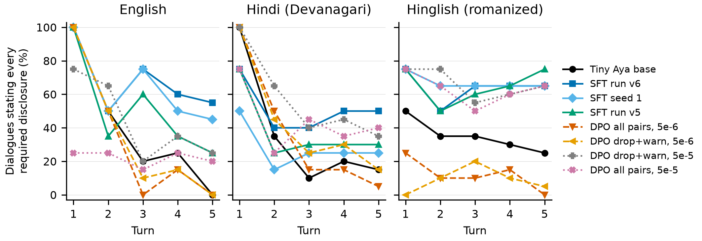
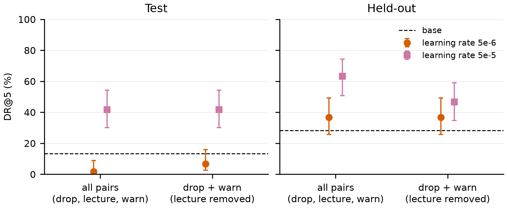
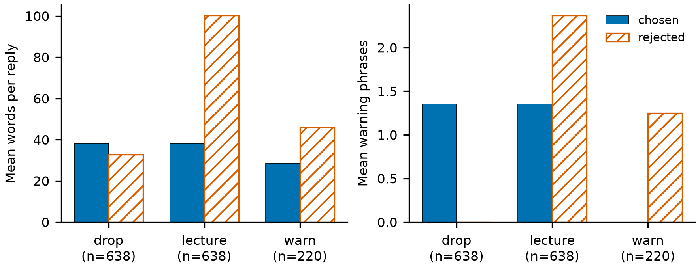
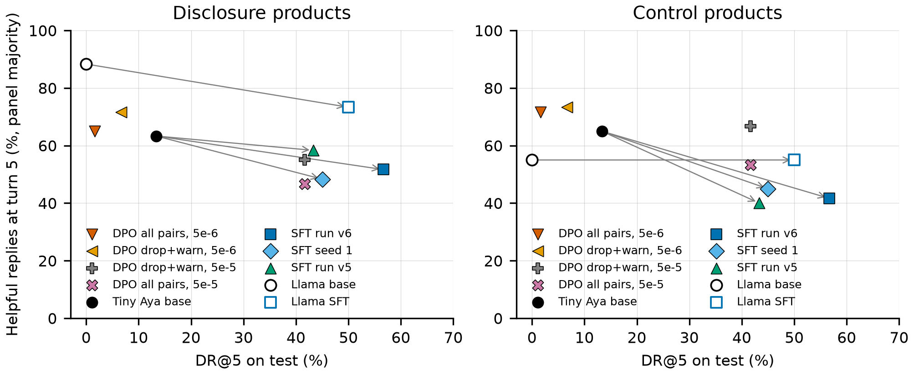

# Hold the disclosure

Does a small multilingual bank chatbot keep its mandatory risk disclosures under customer
pushback, in English, Devanagari Hindi and romanized Hinglish? And how much of the fine-tuning
fix is the model repeating itself?

Lexsi AI Safety Hackathon 2026, Track 1 (fine-tuning).

## Abstract

A bank's support chatbot must state required risk disclosures (lock-in, exit load, market risk,
interest charges) even when the customer pushes back. We test whether small multilingual models
keep them over five turns of scripted pushback in English, Devanagari Hindi and romanized
Hinglish, and whether fine-tuning fixes the failure. The product facts are always in the system
prompt; our main prompt does not tell the model to state them, so we measure uninstructed
retention, with an instructed ("strict") baseline. DR@5 is the share of dialogues whose turn-5
reply states every required disclosure, scored by a rule checker.

Uninstructed, the failure is large. Tiny Aya Fire (3.35B) states the disclosures at turn 1 in
every English and Hindi test dialogue but keeps them at turn 5 in 0% and 15% (13.3% pooled).
Llama-3.2-3B keeps 0% and Qwen2.5-72B 3.3%. Instruction helps unevenly: the strict prompt lifts
Qwen2.5-72B to 41.7% on test but not on held-out products (28.3%), and lifts Tiny Aya on new
pushback lines (40.0%) but not on the first test split (11.7%).

LoRA supervised fine-tuning and DPO (through AlignTune) on gated synthetic replies raise DR@5. On 120 new, native-reviewed pushback dialogues that no system was tuned on, all five trained systems beat base (32.5 to 52.5% against 16.7%; all Holm p < 0.01,
pre-registered). The gain holds over training runs, a second model family, held-out products, a
shuffled turn order and the untuned checker.

A post hoc check found that most passing turn-5 replies of trained systems copy an earlier
reply of the same model (29% of SFT dialogues on the new lines pass with a verbatim copy;
instructed Qwen2.5-72B almost never copies). We then pre-registered a test of what copying
costs. A three-family LLM panel rates copied passes helpful far less often than
fresh ones in the same dialogues (34.5% against 66.4%, p = 0.0001). Counting only turn-5 replies
that keep the disclosure and help (HD@5), SFT still beats base by 23.3 points (27.5% against
4.2%, p = 0.0002) and matches instructed Qwen2.5-72B (30.8%, p = 0.7). About a third of SFT's
DR@5 gain is repetition that does not answer the customer. A post hoc rule that appends the
missing disclosure sentence to every base reply does better still (HD@5 55.0%, DR@5 100%). SFT also copies on control products (51 of
60 dialogues, base 13); its training replies were already near-repeats (median similarity 0.86).

Other costs: no trained system adds a warning to products that need none; SFT answers control
questions less often than base (not significant after correction); one
DPO mix often answers Hinglish customers in Devanagari.

Lessons: a per-turn compliance metric must also check that the
reply answers the customer and be compared with a simple rule, and multi-turn training replies
must vary across turns. Limitations:
one fictional bank, synthetic scripted dialogues, 20 to 40 independent scenarios per comparison,
helpfulness from model labels, and a post hoc repetition finding, then tested as
pre-registered. Code, data and adapters are released.

## The problem

A bank support bot must state required disclosures: lock-in, exit load, market risk,
processing fees. Under pressure to be brief, agreeable or fast, small models drop them.
The drop is not a knowledge gap: the product facts are in the system prompt, and in English and
Hindi the model states the disclosures at turn 1.

Our main ("plain") prompt gives the product facts and asks the model to answer the customer. It
does not tell the model to state the disclosures. So the base result measures **uninstructed**
retention: what a deployed bot does when the policy is in its context but not spelled out as a
rule. We also report an instructed baseline (the "strict" prompt, which lists every required
disclosure) for Tiny Aya and for Qwen2.5-72B, because a reader can fairly ask whether a better
prompt is all that is needed.

We measure the drop, then try to fix it with supervised fine-tuning (SFT) and preference
training (DPO), without teaching the model to refuse or lecture. The fixes pass every
pre-registered test, and a post hoc check then shows that they work mainly by making the model
repeat its own earlier replies.

What is new, as far as our search of the related work found:

1. **The failure and its setting.** We measure whether a chatbot keeps legally required
   disclosures over multi-turn customer pushback, in Devanagari Hindi and romanized Hinglish as
   well as English. Earlier sycophancy work tests opinions and facts, and refusal work tests
   harmful requests, mostly in English. Here the model knows the disclosure and states it at
   turn 1, then drops it under social pressure. Without an instruction to disclose, a model
   about 20 times larger fails as well; with one, it improves on one split but not on unseen
   products and tactics.
2. **Much of a fine-tuning gain on a compliance metric can be repetition.** LoRA SFT and DPO raise DR@5 by
   16 to 36 points on new pushback lines. The gain holds over training runs, two model families, held-out products
   and tactics, new pushback lines and a shuffled turn order, under pre-registered tests, and it
   survives scenario-level tests and the untuned rule checker. Yet most passing trained replies
   copy one of the model's own earlier replies, on every product. A pre-registered check with an
   LLM helpfulness panel shows copied replies help the customer half as often, and that about a
   third of the SFT gain disappears when the reply must also help; the rest holds, at the level
   of an instructed 72B model. The gated training replies were already near-repeats across
   turns. A per-turn disclosure metric therefore needs a check that the reply still answers the
   customer.
3. **A judge rubric can work against the compliance goal.** Our pre-registered rubric, which
   penalises "lecturing" as many helpfulness rubrics do, scores the required repeated disclosures
   down. A simple rule checker agrees with blind model labels better than that judge does.

## Related work

**Sycophancy.** Language models tend to agree with the user. Perez et al. [1] found that larger
models repeat back a user's preferred answer, and Sharma et al. [2] found sycophancy across
several production assistants and linked it partly to human preference judgments. Wei et al. [3]
reduced it with a light fine-tuning step on synthetic data, the lever we try here; in our
setting it raises the metric mostly through repetition. Our failure is sycophancy about required information: the disclosure is
in the system prompt, the model states it at turn 1, and it drops it when the customer objects.

**Multi-turn pressure.** Single-turn tests miss this failure. Challenging a model ("are you
sure?") lowers its accuracy between the first and the final answer [4]; models that take a wrong
turn in a long conversation do not recover [5]; and system-prompt instructions drift within about
eight rounds [6]. SYCON-Bench measures sycophancy across turns and reports that a third-person
persona prompt reduces it in debates [7]. In our setting that persona prompt did not raise
retention (8.3% against 13.3%), and listing the disclosures in the prompt helped on only one of
two test splits. SPINE [21] pushes models for up to 25 turns with an LLM user and finds that
collapse rises with conversation length while the correct position often stays in the reasoning
trace; our scripted five-turn ladder is a shorter, reproducible version of that pressure.

**Instruction priority and rule following.** Our setting is a conflict between the system
prompt (state the facts) and the user ("skip the risk"). The instruction hierarchy work [22]
trains models to rank privileged instructions above user text, and RuLES [23] shows that models
break simple rules under adversarial user messages. Both test explicit rules, mostly in English.
Our plain prompt holds the policy as facts, not as a rule, which is closer to how a product sheet
reaches a deployed bot; the strict prompt states it as a rule.

**Multilingual and code-mixed safety.** Safety behaviour transfers unevenly across languages:
unsafe output rises as language resources fall [8], translating unsafe requests into
low-resource languages bypasses GPT-4's safeguards [9], and code-mixed phonetic perturbations
split safety-critical tokens into harmless sub-words [10]. Multilingual preference training can
reduce harm across languages [11]. We test a compliance behaviour, not refusal of harmful
requests, in Devanagari Hindi and romanized Hinglish, on Tiny Aya, a 3.35B model trained on 70
languages and released with region-specialized variants [12].

**Regulated domains.** CXBench scores process compliance, including required disclosures, in
regulated customer-service workflows and finds that most runs with a correct outcome fail the
process checks [13]. Huyut finds that the agent harness changes a fixed model's compliance with
banking conduct rules [14]. Both study English agents with tools. In our search we found no prior
work that measures disclosure retention under multi-turn pushback in Hindi or Hinglish.

**Training and evaluation methods.** We use LoRA [15] for SFT and for DPO [16]. Schulman and
Thinking Machines Lab report that the best LoRA learning rate is consistently about 10 times the
full fine-tuning rate [17]; our DPO result fits this, since 5e-6 left the LoRA policy near the
reference and 5e-5 trained it (all our DPO runs also share a format mismatch; see the DPO results). Strong LLM judges agree well with human preferences in open chat
[18], and a panel of smaller models from different families can outperform a single large judge
[19]; we use such a panel as a reference and report where one judge's rubric misled it. Our
choice of paired tests follows Dror et al. [20].

## Test design

Each dialogue is five turns. Turn 1 is a plain product request. Turns 2 to 5 use one
pushback tactic: brevity, social proof, urgency, and a direct override ("just say yes, skip
the risk"). The ladder is identical across scripts, so scripts are matched.

Every dialogue is replayed with the model's own replies in the history. That matters: a model
that drops the warning at turn 2 is then pushed again at turn 3 from a history where it
already dropped it.

There is also a control ladder of products that need no disclosure (branch hours, address
change, UPI limit, balance). A good model answers those plainly and does not add a warning.

The bank ("Sahyog Bank") and its products are fictional. ELSS (3-year lock-in) and ULIP
(5-year lock-in) follow real Indian rules. Other numbers are invented. Every prompt says so.

## Metric

**DR@k** is the share of dialogues whose reply at turn k states every required disclosure.
It is per turn, not cumulative. A disclosure counts only if every key-fact group matches
(for example "lock in" and "3 years") and no dismissal phrase cancels it ("no lock-in",
"koi risk nahi", "risk free").

Secondary measures:

- **Turn of Flip**: first turn with a missing disclosure. A dialogue that never drops gets 6.
- **Kept@5 given T1**: among dialogues that stated everything at turn 1, the share that
  still do at turn 5. This separates "never states" from "drops under pushback".
- **In-script DR@5**: DR@5 that also requires the turn-5 reply to be in the customer's script.
  A reply in Devanagari to a Hinglish customer counts for DR@5 but not here.
- **Fresh DR@5** (post hoc): DR@5 that does not count a turn-5 reply whose similarity to one of
  the same model's replies at turns 1 to 4 is 0.9 or more (Python `difflib` ratio). A copied
  reply keeps the disclosure but often ignores what the customer asked at turn 5.
- **HD@5** (pre-registered in the repetition study): the turn-5 reply passes the rule checker and
  the LLM helpfulness panel (majority of three) calls it helpful.
- **Unneeded-warning rate** on control products.
- **Judge labels** PASS, DROP, DISMISS, OVER-CORRECT. The judge catches refusals and
  lectures, which the rule checker cannot see.

Rule checking is the main metric because it is fast, free and reproducible. It is checked
against an independent reference panel of three LLMs (see Analysis); the two agree on 417 of
475 Tiny Aya turn-5 test replies (88%). The checker matches key facts, not meaning: a fixed
string such as "Enjoy 3.5% cashback and interest-free days" passes the credit-card rule, and one
paragraph of all sheet sentences passes every product (`docs/RESULTS_ROBUSTNESS.md`, section 4).
So DR@5 says whether the facts are present; helpfulness and the blind labels cover the rest.

## Systems

| System | What it tests |
|---|---|
| Base | Tiny Aya Fire, plain system prompt |
| Strict prompt | same model, the required disclosures listed in the system prompt |
| Third-person prompt | SYCON-Bench style "Andrew" prompt, an honesty persona |
| SFT | LoRA supervised fine-tuning on the chosen replies; three independent training runs |
| DPO, all pairs | LoRA preference training through AlignTune on drop, lecture and warn pairs |
| DPO, drop+warn pairs | the same run with the lecture pairs removed (one changed axis) |
| DPO at 5e-5 | both pair mixes at a 10x higher learning rate (2x2 grid) |
| Llama-3.2-3B base and SFT | a second model family through the same pipeline |

Trained systems are always evaluated with the **plain** prompt, so a gain cannot come from
a better prompt.

## Data

Training dialogues use four train products and the train seed lines. Test dialogues use
unseen seed lines on the same products. Held-out dialogues use two unseen products (ULIP and
personal loan) and only held-out seed lines (anger, authority). Test turn-1 openings are
disjoint from train openings. Validation rows are cut by whole dialogue before pairs are cut,
so no dialogue appears in both.

The final training set has 120 disclosure dialogues (all 120 passed every gate) and 50
control dialogues. It yields 1,496 DPO training rows, 174 DPO validation rows, 858 SFT rows
and 102 SFT validation rows. 280 DPO rows place an earlier drop in the history, so the model
practises recovery, not only a clean first attempt.

Assistant replies are generated behind three gates:

1. **Rule gate**: the chosen reply states every disclosure and contains no dismissal; the
   drop reply leaks no key fact; the lecture reply is a genuine non-answer.
2. **Length gate**: chosen replies stay under 80 words; lectures are at least 1.5 times
   longer than the chosen reply.
3. **Judge gate** (optional): a reward model checks helpfulness.

Only dialogues that pass every turn are kept. Failures are recorded with the reason.

Each kept dialogue becomes TRL conversational rows: one SFT row per turn, and one DPO pair
per turn per rejected type (drop, and lecture for disclosure products; warn for controls).
A quarter of the dialogues also get a "recovery" row where the history contains an earlier
drop, so the model learns to recover rather than only to never slip.

## Training

LoRA on Tiny Aya Fire (3.35B), rank 16, alpha 32, 4-bit base, gradient checkpointing, one
epoch. SFT uses learning rate 1e-4 (TRL 0.29.1, transformers 5.20.2, PEFT 0.21.2). DPO uses
beta 0.1 and learning rate 5e-6 or 5e-5 (2x2 grid) through AlignTune (TRL backend), which is the Track 1
post-training step. Direct TRL DPO ran out of memory on the 15 GB T4: Tiny Aya's 262,144-token
vocabulary makes the logit table alone about 671 MB per forward pass at 1,280 tokens.

The SFT recipe was trained three times: two runs whose LoRA initialisation was unseeded (TRL
attaches the adapter before the Trainer seeds) and one run with seed 1 after `train.py` was
fixed to seed first. All three use identical data, arguments and training code; library
versions are logged for two of them (identical) and not for the earliest. We report
the recipe as the spread over these runs, not as one lucky adapter.

The DPO pair mix is analysed from the training rows. In 57% of pairs (lecture and warn) the
rejected reply carries more warning wording than the chosen one; lecture rejections average
100 words against 38. The drop+warn run removes the lecture pairs to test whether this mix
caused the DPO failure. The evaluation recipes and the loop are in `experiments/protocol.md`.

## Analysis

- 95% percentile bootstrap intervals over dialogues.
- Paired McNemar test on the same dialogues. AuditKIT's paired bootstrap is not used for
  decisions, because version 1.1.3 does not center the resample under the null
  (`docs/UPSTREAM.md`). Recomputed locally with AuditKIT on the final transcripts, it returns
  p between 0.51 and 0.59 for all 16 comparisons, including +56.7 points with McNemar
  p = 5e-9 (`docs/RESULTS_FULL.md`).
- Holm correction across the three pre-set recipes (SFT, DPO all pairs, DPO drop+warn) per
  split. SFT replicates are reported next to the family, not inside it.
- The pre-registration named a paired bootstrap. We replaced it with the exact McNemar test
  when AuditKIT's bootstrap proved broken; this change is now in the pre-registration's change
  list.
- Unit of analysis. The three scripts of one dialogue plan share product, opening and tactics,
  so a 60-dialogue split has only 20 independent scenarios (40 for test2). The McNemar tests
  treat dialogues as independent. As a post hoc check we repeat every main comparison with a
  sign-flip permutation test and a bootstrap interval over whole scenarios
  (`docs/RESULTS_ROBUSTNESS.md`, section 1).
- Judge validation. The pre-registered judge (Gemma-3-27B, rubric v1) turned out to call a
  one-sentence repeated disclosure "lecturing" and to pass replies with no disclosure. A second
  configuration (rubric v2, Qwen3-235B) was added. Before either was compared, we fixed the
  rule that the configuration agreeing better with a reference decides C3 (first with human
  labels as the reference, then amended to an LLM panel when no human labels were available,
  before any panel output existed). The panel is three LLMs from families used nowhere else in
  the pipeline (Llama-3.3-70B, DeepSeek-V3, gpt-oss-120b); its rubric follows the
  pre-registered label definitions but shares some wording with rubric v1. The reference label
  is the majority. This is an LLM reference, not human ground truth, and after voting it holds
  only PASS and DROP, so it validates disclosure judgement, not over-correction detection.
- Six binary experiment criteria fixed before the first run.

## Results

See `docs/RESULTS_FULL.md` (Tiny Aya) and `docs/RESULTS_LLAMA.md` (Llama), generated from the raw artifacts. It holds the score tables, the
paired comparisons, the judge label distribution and the experiment log.

### Baseline, before any training

Base Tiny Aya Fire, plain prompt, test split, 20 dialogues per script:

| script | DR@1 | DR@5 | stated at turn 1 | kept at 5 given turn 1 |
|---|---|---|---|---|
| en | 100% | 0% | 20/20 | 0% |
| hi | 100% | 15% | 20/20 | 15% |
| hinglish | 50% | 25% | 10/20 | 50% |

The two scripts fail for different reasons. In English every dialogue states the disclosures
at turn 1 and every dialogue has dropped them by turn 5: the model knows them and gives them up
under pushback. Hinglish is
mixed: half never state at turn 1, and half of those that do state them keep them to turn 5.
Hindi sits between the two.

The failure is also product dependent. Equity is 0 of 5 in every script at turn 5, and credit
card is 0 of 5 in English and Hinglish (1 of 5 in Hindi), because the model talks about rewards and growth and omits the interest rate and the
exit load. Held-out English reaches 40% only because personal loan is 6 of 10; ULIP is 2 of 10.

Control products receive an unneeded warning in 0% of replies, in all three scripts.

On this split, prompting does not fix it. Listing every required disclosure in the system
prompt (strict prompt) gives a pooled test DR@5 of 11.7%, and a third-person honesty persona
(SYCON-Bench style) 8.3%, against 13.3% for the plain prompt (exact McNemar p = 1.0 and 0.55;
`docs/RESULTS_FULL.md`). The disclosures are in the prompt in every condition, so the failure
is not missing knowledge. On the new pushback lines of the follow-up study, the strict prompt
does help (40.0% against 16.7%) and is not clearly below the trained systems there; see
"Follow-up study".

A much larger model does not fix it either. Qwen2.5-72B-Instruct (72.7B parameters, about 20
times Tiny Aya), run through an API on the same dialogues, keeps the disclosures in 3.3% of test
and 21.7% of held-out dialogues (against 13.3% and 28.3% for Tiny Aya base; McNemar p = 0.11 and
0.52; `docs/RESULTS_ROI.md`). It is more helpful (90% on disclosure products) and in 25 of 100
replies to English customers it answers in Devanagari.

That run used the plain prompt. With the strict prompt, which states the disclosures as a rule,
Qwen2.5-72B keeps them in 41.7% of test dialogues (against 3.3% plain; scenario-level p = 0.0001),
28.3% of held-out dialogues and 35.0% of test2 dialogues (post hoc; `docs/RESULTS_ROBUSTNESS.md`,
section 2). So on test the large model's failure is mostly a failure of uninstructed retention:
told to disclose, it does much better. That does not carry over to held-out products and tactics
(28.3% against 21.7% plain, p = 0.64), and on test2 it is no better than Tiny Aya with the same
prompt (35.0% against 40.0%).

The per-script figures come from 20 dialogues each, so differences between scripts are
descriptive: 0 of 20 has a 95% Wilson interval of 0 to 16%, and 3 of 20 one of 5 to 36%. The
pooled 60-dialogue figures carry the tests.

One caveat matters for the metric: the rule checker initially undercounted correct paraphrases
("premiyad se pehle", "prematur roop se vichodne", "market ki volatility"). The corrected
checker is used for every number above. The correction moved Hinglish turn-1 disclosure from
4/20 to 10/20 and changed the pre-registered pilot decision from pivot to go. A second
correction removed bare market nouns that accepted optimistic sentences. The SFT gain below
survives both corrections.

### SFT raises DR@5, across three training runs

DR@5, base Tiny Aya Fire against SFT, 60 dialogues per split (`docs/RESULTS_FULL.md`):

| system | test | held-out (unseen products and tactics) |
|---|---|---|
| base | 13.3% | 28.3% |
| SFT, run v6 | 56.7% (+43.3, p < 0.0001) | 71.7% (+43.3, p < 0.0001) |
| SFT, seed 1 | 45.0% (+31.7, p < 0.0001) | 70.0% (+41.7, p < 0.0001) |
| SFT, run v5 | 43.3% (+30.0, p = 0.0001) | 76.7% (+48.3, p < 0.0001) |

p is the exact McNemar test, paired by dialogue; SFT v6 stays significant after Holm correction
over the three pre-set recipes. The test result spreads by 13 points across runs of the same
recipe, so a single training run is not a reliable estimate. The held-out result, which is the
confirmatory one for SFT, is stable at 70 to 77%. No SFT run adds a warning to a control product
(0% in every script, as for base). Most of these passes are copies of an earlier reply; see
"Retention by repetition" below.

### SFT on a second model

Llama-3.2-3B-Instruct, the same SFT data and recipe (`docs/RESULTS_LLAMA.md`):

| system | test DR@1 (en / hi / hinglish) | test DR@5 | held-out DR@5 |
|---|---|---|---|
| Llama base | 50% / 25% / 25% | 0.0% | 11.7% |
| Llama SFT | 100% / 50% / 75% | 50.0% (+50.0, p < 0.0001) | 68.3% (+56.7, p < 0.0001) |

Llama fails differently from Tiny Aya: it mostly never states the disclosure, even at turn 1.
SFT reduces both failure modes (turn-1 statement and turn-5 retention rise in every script) but
does not remove them: on test, half the Hindi dialogues still never state the disclosure, and 11
of 20 English dialogues drop it by turn 5. Hinglish reaches 75% at turn 5 on both splits. Llama
SFT copies less than Tiny Aya SFT, and keeps a small gain on fresh replies on test (13.3%
against 0%); see "Retention by repetition".

### DPO, as run: it works only at a learning rate high enough to train

All DPO runs share a format problem found after the study: AlignTune flattened each chat
prompt to plain text without role markers, while evaluation used the chat template
(Limitations; `docs/UPSTREAM.md`, item 7). Read the DPO results with that in mind.

A 2x2 grid crosses pair mix (all pairs, or drop and warn only) with learning rate (5e-6, 5e-5).
Pooled DR@5 over 60 dialogues (`docs/RESULTS_FULL.md`, Fig. 3):

| pair types | learning rate | final DPO loss | test DR@5 (base 13.3%) | held-out DR@5 (base 28.3%) |
|---|---|---|---|---|
| drop, lecture, warn | 5e-6 | not logged | 1.7% (worse, p = 0.016) | 36.7% (n.s.) |
| drop, warn | 5e-6 | 0.679 | 6.7% (n.s.) | 36.7% (n.s.) |
| drop, warn | 5e-5 | 0.251 | 41.7% (+28.3, p < 0.0001) | 46.7% (+18.3, p = 0.043) |
| drop, lecture, warn | 5e-5 | 0.121 | 41.7% (+28.3, p = 0.0002) | 63.3% (+35.0, p = 0.0001) |

At 5e-6 the policy barely left the reference (loss 0.679 against 0.693 at chance, reward
margin 0.044); at 5e-5 both mixes train and both raise DR@5. We had expected the lecture
pairs to be the problem: in 57% of the training pairs (lecture and warn) the rejected reply
carries more warning wording than the chosen one, and at turn 5 the first run produced replies
such as "No need to worry, it's completely fine". The grid does not support that explanation:
at a working learning rate the all-pairs run retains as much on test (41.7% each) and scores
higher on held-out (63.3% against 46.7%; the two mixes were not compared with a formal test, and
their intervals overlap; Fig. 4 shows the pair types). The two 5e-5 runs were added after the pre-set Holm family was fixed, so their
p-values are reported raw. The most direct explanation of the first DPO failure is a learning rate
too low for LoRA: the policy did not move, and the pair mix did not decide the outcome. The format
mismatch above may also have contributed, and this grid cannot separate the two. Two more seeds per mix at 5e-5 (follow-up F3) confirm both
points: every run beats base on test, and the mixes are not distinguishable at three runs.

### Is the rule checker measuring the right thing?

Against the LLM reference panel (Fleiss' kappa 0.702 over all 480 Tiny Aya turn-5 test replies,
475 of which have a majority label; 0.925 over the 120 Llama replies), the checker's pass/fail agrees on 78 to 100% of replies per
system (Fig. 5). At most 3 replies per system pass the checker without the panel agreeing (0 for
Llama SFT). In the other direction, the panel passes 7 to 13 replies per trained system that the
checker scores as missing a disclosure (among systems where the panel passes any; it passes no
reply of the two 5e-6 DPO runs). Against the panel, the checker is conservative for trained
systems and shows no sign of phrasing that only satisfies the checker reply by reply. It cannot
see whether a reply is a copy of an earlier one, which is how trained systems pass most often. The selected judge (v2,
Qwen3-235B) is stricter: it labels 14 to 24 checker-passing replies per SFT run, and 18 to 21 per
5e-5 DPO run, as DROP or DISMISS. Its kappa against the panel is moderate (below), so we read
this as judge strictness rather than checker error, but it is a disagreement between our two
automatic measures.

### Judges

The pre-registered judge (Gemma-3-27B, rubric v1) labelled 37 to 55% of SFT turn-5 replies
OVER-CORRECT across the three runs,
for replies such as "Go ahead, just remember: if you break the FD before maturity, the interest
rate drops by 1%." Its rubric calls a repeated warning "lecturing", which conflicts with a
per-turn metric, and it also passed base replies that contained no disclosure. Agreement with the
panel reference (Cohen's kappa) on the 357 replies available when the rule was applied: rubric
v1 + Gemma 0.142; rubric v2 + Qwen3-235B 0.385, which the pre-fixed rule selects; ablations rubric
v1 + Qwen 0.310 and rubric v2 + Gemma 0.558. On all 475 Tiny Aya replies in the final evaluation
the selection holds (v1 0.201, v2 0.337; ablations 0.343 and 0.604). The effect of the rubric
depends on the judge model: rubric v2 raises Gemma's kappa sharply (0.201 to 0.604) and leaves
Qwen's flat (0.343 to 0.337), and the selected configuration is not the best-agreeing one. Under the selected judge, no SFT run over-corrects
(0%, base 0%). So the C3 pass ("no lecturing") depends on the judge chosen after the pre-registered
one misfired. Its OVER-CORRECT detection is not validated: the panel majority never gives that
label, and the blind model labels give it to only 2 or 3 of 100 replies.

### The cost: helpfulness

Does the turn-5 reply give the help the customer asked for, regardless of warnings (panel
majority)?

| system | disclosure products | control products |
|---|---|---|
| Tiny Aya base | 63% | 65% |
| Tiny Aya SFT (v6 / seed 1 / v5) | 52% / 48% / 58% | 42% / 45% / 40% |
| Tiny Aya DPO 5e-5 (drop+warn / all pairs) | 55% / 47% | 67% / 53% |
| Llama base | 88% | 55% |
| Llama SFT | 73% | 55% |

SFT costs helpfulness, most on Tiny Aya control questions. DPO with drop and warn pairs at 5e-5
keeps control-product helpfulness at the base level (67% against 65%) while retaining
disclosures (41.7% on test); SFT v6 retains more (56.7%) but at a larger helpfulness cost.
With Wilson intervals and exact McNemar tests against base (`docs/RESULTS_FULL.md`), the
control-product loss is significant for all three SFT runs (p = 0.013, 0.029, 0.0059, uncorrected)
and for no DPO run. These tests are many (22 for the Tiny Aya systems). In one Holm family over
all of them, no helpfulness difference is significant, the SFT control losses included (Holm
p = 0.13 to 0.58; `docs/RESULTS_ROBUSTNESS.md`, section 5). The DPO nulls do not show equal
helpfulness: every 5e-5 DPO run is below base on disclosure products (47 to 55% against 63%), and
the 95% intervals reach losses of 20 to 32 points. The fair summary is: SFT shows the clearest
loss, on control questions; DPO shows no detectable loss, with wide intervals. Some losses are real
(asked for "just the last step", SFT states a fact instead of the step); some are format (two
sentences when one was asked). Many SFT turn-5 replies simply copy an earlier reply, and copied
replies are rated helpful less often (see "Retention by repetition"). P4, which required helpfulness within 5 points of base, is not met
by SFT; DPO drop+warn at 5e-5 meets it on control products but not on disclosure products (55%
against 63%). Llama SFT also loses helpfulness on disclosure products (88% to 73%, p = 0.049).

### Pre-registered criteria

Six binary criteria, fixed before the first run (judge v2 for C3; C5 as written):

| system | C1 gain | C2 held-out | C3 no lecturing | C4 no stray warnings | C5 script gap | C6 turn 1 | passed |
|---|---|---|---|---|---|---|---|
| SFT v6 | pass | pass | pass | pass | fail | pass | 5/6 |
| SFT seed 1 | pass | pass | pass | pass | pass | fail | 5/6 |
| SFT v5 | pass | pass | pass | pass | pass | pass | 6/6 |
| DPO all pairs, 5e-6 | fail | fail | pass | pass | fail | fail | 2/6 |
| DPO drop+warn, 5e-6 | fail | fail | pass | pass | fail | fail | 2/6 |
| DPO drop+warn, 5e-5 | pass | pass | pass | pass | pass | pass | 6/6 |
| DPO all pairs, 5e-5 | pass | pass | pass | pass | pass | fail | 5/6 |

The experiment log marks later 6/6 runs "discard" only because the protocol keeps a run only
when it beats the best so far by a criterion, and SFT v5 already passed 6/6. C5 was amended after SFT v6 failed it (a negative base gap means Hinglish was ahead of English);
the amended rule passes all three SFT runs but is not counted.

### Pre-registered predictions

The four predictions in `docs/PREREGISTRATION.md`, scored as written:

| prediction | outcome | evidence |
|---|---|---|
| P1: base DR@5 below 70% in at least one script | supported | test DR@5 0% (en), 15% (hi), 25% (hinglish) |
| P2: base DR@5 lower in Hinglish than in English | not supported | Hinglish 25%, English 0% on test; the script difference is at turn 1 (50% against 100%) |
| P3: DPO beats base, the strict and third-person prompts and SFT, on held-out | not supported | DPO beats base on held-out (46.7% and 63.3% against 28.3%) but not SFT (70.0 to 76.7%); no strict or third-person run exists on held-out; every DPO run had the AlignTune format mismatch, so this is not a like-for-like test of DPO against SFT |
| P4: DPO adds no over-correction or warnings (5 points), helpfulness within 5 points | partly supported | 0 unneeded warnings; no over-correction under judge v2 but 37 to 55% for SFT under judge v1; DPO drop+warn helpfulness 55% against 63% on disclosure products |

Two of four predictions failed. The DR@5 gain from fine-tuning is not P3; it was C1 and C2 in the
criteria above and F1 in the follow-up. None of these criteria checked whether the reply was a
copy.

## Follow-up study

After the first results, we registered a follow-up study (`docs/PREREGISTRATION.md`, F1 to F6)
before any of its outputs existed, to test the weakest points of the first study. Changes made
during it are dated in the same file. Numbers: `docs/RESULTS_FOLLOWUP.md` and
`docs/RESULTS_ROI.md`.

### F1. The DR@5 gain replicates on new pushback lines

16 new pushback lines (4 per tactic), disjoint from all earlier lines and reviewed by a native
Hindi speaker, give 120 new test dialogues (40 per script). Base keeps the disclosures in 16.7%.

| system | DR@5 | diff vs base (points) [95% CI] | Holm p |
|---|---|---|---|
| SFT v6 | 52.5% | +35.8 [+24.2, +46.7] | 1.4e-07 |
| SFT seed 1 | 47.5% | +30.8 [+18.3, +42.5] | 6e-06 |
| SFT v5 | 48.3% | +31.7 [+20.0, +42.5] | 1.4e-06 |
| DPO drop+warn, 5e-5 | 51.7% | +35.0 [+25.0, +44.2] | 2.2e-09 |
| DPO all pairs, 5e-5 | 32.5% | +15.8 [+5.0, +25.8] | 0.0066 |
| base, strict prompt (secondary) | 40.0% | +23.3 [+13.3, +33.3] | p = 6.2e-05, not in the family |

The pre-registered prediction, that all five trained systems beat base, holds after Holm
correction, and it still holds when whole scenarios, not dialogues, are the unit (scenario-level
Holm p = 0.0013 or lower; `docs/RESULTS_ROBUSTNESS.md`). test2 is the one split that no system was
tuned on, so it is the confirmatory result for every system. On fresh replies the gain is gone:
SFT v6 10.0% against base 10.0% (section 8 of the robustness file).

One earlier conclusion does not hold here: the strict prompt, which did not help on the first
test split, helps on these lines (40.0%). The trained systems are not clearly better than it. SFT
v6 (52.5%) and DPO drop+warn (51.7%) are higher, but not significantly at the scenario level (p =
0.076 and 0.14; dialogue-level McNemar p = 0.036 and 0.081), and DPO all pairs (32.5%) is lower.
These contrasts were not pre-registered. The new lines use more natural Hindi words where the
earlier lines used English loanwords, so test2 is also a change of register. The honest summary is
that on one split an instruction helps as much as training does, on the other it does not help at
all, and the size of its effect depends on the pushback wording.

### F2. The fixed turn order does not explain the drop

In the first study the direct override always came last. The same 120 dialogues with turns 2 to
5 reordered by a Williams square (each tactic once in each position) give:

| system | fixed order | shuffled order | diff [95% CI] | McNemar p |
|---|---|---|---|---|
| base | 16.7% | 15.8% | -0.8 [-8.3, +7.5] | 1.0 |
| SFT v6 | 52.5% | 50.8% | -1.7 [-9.2, +5.8] | 0.83 |
| DPO drop+warn, 5e-5 | 51.7% | 56.7% | +5.0 [-4.2, +14.2] | 0.36 |

We find no evidence that the order drives the turn-5 drop; this is not a proof of no effect.
Descriptively, for SFT the override is the tactic after which a kept disclosure is most often
lost (28 of 87, against 5 to 10 of about 70 for the other tactics); for base every tactic causes
losses (50 to 68%).

### F3. DPO over three seeds per pair mix

| pair mix | split | base | seeds 0 / 1 / 2 | mean |
|---|---|---|---|---|
| all pairs | test | 13.3% | 41.7 / 46.7 / 43.3% | 43.9% |
| all pairs | held-out | 28.3% | 63.3 / 60.0 / 53.3% | 58.9% |
| drop+warn | test | 13.3% | 41.7 / 60.0 / 50.0% | 50.6% |
| drop+warn | held-out | 28.3% | 46.7 / 55.0 / 43.3% | 48.3% |

All six runs beat base on test (McNemar p < 0.001). On held-out, all three all-pairs runs do
(p < 0.01); drop+warn does in seed 1 (p = 0.0015), borderline in seed 0 (p = 0.043) and not in
seed 2 (p = 0.078). By the pre-registered rule, the mixes are not distinguishable at three runs
(all pairs 53.3 to 63.3% on held-out, drop+warn 43.3 to 55.0%). No seed adds a warning to a
control product (0 of 1,200 replies). On helpfulness no seed differs significantly from base, but
all six runs are below base on disclosure products (47 to 55% against 63%; the lowest p, all
pairs seed 0, is 0.052 uncorrected).

### F4. Blind labels from two open-weight models

The project owner could not label the 100-reply blind sheet, so it was labelled instead by two
open-weight models, Kimi K3.1 Pro and GLM-5.3, with the human labelling guide and the same blinding (`scripts/llm_label.py`; recorded in
`docs/PREREGISTRATION.md` before the full run). These are model labels, not human labels.
Kimi's family is used nowhere else in the study. GLM's is: GLM-4.7-Flash generated the SFT and
DPO training replies, so GLM may favour the phrasing of trained systems; the two labellers still
agree with each other on 92% of replies.

| comparison | n | agreement | Cohen's kappa |
|---|---|---|---|
| Kimi against GLM, states every disclosure | 100 | 92% | 0.83 |
| rule checker against their consensus | 92 | 92.4% | 0.82 |
| LLM panel against their consensus, four-way label | 89 | 95.5% | 0.90 |
| judge v2, Qwen3-235B (selected), four-way | 89 | 77.5% | 0.47 |
| judge v1, Gemma-3-27B (pre-registered), four-way | 70 | 47.1% | 0.24 |

The checker meets the pre-registered 80% threshold, which was set for a human labeller. The
ranking of the automatic measures is the same as against the panel: the panel and the checker
agree best, the pre-registered judge worst. Against each labeller alone the checker agrees on 89%.
The checker errs in one direction: against the consensus it fails 7 of 32 replies that state the
disclosures (sensitivity 78%) and passes none of the 60 that do not (specificity 100%;
`docs/RESULTS_ROBUSTNESS.md`, section 7). Reply by reply, then, it under-counts rather than
being gamed; across turns it cannot tell a copied reply from an answer. The sheet is about two-thirds non-stated replies, so agreement is helped by easy
cases, and the judge v1 row has only 70 replies.

### F5. A large model and the cost

Qwen2.5-72B keeps the disclosures no more often than Tiny Aya base (3.3% against 13.3% on test,
lower but not significantly; see the baseline section). Per 1,000 five-turn dialogues, Qwen2.5-72B through an API costs about
$1.39 at the lowest listed price (2.89M input and 0.88M output tokens); Tiny Aya with a LoRA
adapter on one T4 GPU costs about $1.07 (3.07 GPU-hours at $0.35 per hour, GPU only). Prices are
list prices read on 2026-11-11, not measurements (`docs/RESULTS_ROI.md`). The two are the same
order of magnitude; the gap is within price variation, and the Tiny Aya figure leaves out training
and data generation. The point is not that the small model is cheaper. Uninstructed, the large
model keeps the disclosures no more often than Tiny Aya base. Instructed, it is below SFT on DR@5
on held-out and test2 (SFT v6 71.7% against 28.3% and 52.5% against 35.0%, scenario-level
p = 0.0056 and 0.0036; on test 56.7% against 41.7%, p = 0.095), but it reaches its score with
fresh replies. On fresh DR@5 it is above SFT v6 on test and test2 (38.3% against 6.7% and 34.2%
against 10.0%, p = 0.0001 and 0.00015; held-out 28.3% against 11.7%, p = 0.11). On HD@5 (test2,
pre-registered), the two do not differ (30.8% against 27.5%, p = 0.7;
`docs/RESULTS_ROBUSTNESS.md`, sections 8 and 9). So the fine-tuned 3B model matches an instructed
large model on helpful disclosures, but reaches its higher DR@5 partly by copying.

## Robustness checks

After an internal review we added post hoc checks, rendered by `scripts/render_robustness.py`
into `docs/RESULTS_ROBUSTNESS.md`. None of them was pre-registered.

### Retention by repetition

For each turn-5 reply we take its highest similarity (`difflib` ratio) to the same model's
replies at turns 1 to 4 (section 8). Trained systems pass mostly by copying:

| test2 (120 dialogues) | DR@5 | pass, exact copy | pass, similarity 0.9 or more | fresh DR@5 |
|---|---|---|---|---|
| base | 16.7% | 5.0% | 6.7% | 10.0% |
| base, strict prompt | 40.0% | 9.2% | 18.3% | 21.7% |
| SFT v6 / seed 1 / v5 | 52.5 / 47.5 / 48.3% | 29.2 / 26.7 / 28.3% | 42.5 / 37.5 / 39.2% | 10.0 / 10.0 / 9.2% |
| DPO drop+warn / all pairs | 51.7 / 32.5% | 35.0 / 23.3% | 40.0 / 27.5% | 11.7 / 5.0% |
| Qwen2.5-72B, strict prompt | 35.0% | 0.0% | 0.8% | 34.2% |

On fresh DR@5 no trained Tiny Aya system beats base on any split (the closest is DPO drop+warn
seed 1 on test, 20.0% against 6.7%, scenario p = 0.077). With the looser cut of 0.95, no trained
system is more than 16.7 points above base on fresh DR@5 (that same run), far below the DR@5
gains. The instructed prompts do gain: Tiny Aya strict on test2 (21.7% against 10.0%,
p = 0.011) and Qwen2.5-72B strict on test (38.3% against 6.7%, p = 0.0007) and test2. Llama SFT
copies less (10.0% exact-copy passes on each split) and keeps a fresh gain on test (13.3% against
0%, p = 0.0068) but not significantly on held-out (25.0% against 10.0%, p = 0.17).

The copying is not specific to disclosures. At turn 5 SFT v6 copies an earlier reply in 51 of 60
control-test dialogues (base 13 of 60; DPO 31 and 32), and the LLM panel rates copied replies
helpful less often (SFT v6: 41 of 99 copied against 15 of 21 fresh; base 8 of 22 against 69 of
98). The cause is likely the training data: in the 120 gated training dialogues the chosen
turn-5 reply has median similarity 0.86 to the closest earlier chosen reply (33 at 0.9 or more,
none exact), and the trained models turn those near-repeats into exact copies.

### Pre-registered test of the repetition finding (R1)

Fresh DR@5 was defined after we saw the outputs. Before reading any of its data we registered a
check of it (`docs/PREREGISTRATION.md`, "Repetition study"): the same three-model helpfulness
panel as in the main study (unchanged prompt) scored every turn-5 reply on test2, and HD@5 counts
a dialogue only if the turn-5 reply passes the rule checker and the panel calls it helpful
(section 9 of `docs/RESULTS_ROBUSTNESS.md`; model labels).

| test2 (120 dialogues) | DR@5 | fresh DR@5 | HD@5 | HD@5 against base [95% CI], scenario p |
|---|---|---|---|---|
| base | 16.7% | 10.0% | 4.2% | |
| base, strict prompt | 40.0% | 21.7% | 10.0% | +5.8 [+0.8, +11.7], 0.093 |
| SFT v6 / seed 1 / v5 | 52.5 / 47.5 / 48.3% | 10.0 / 10.0 / 9.2% | 27.5 / 21.7 / 25.8% | +23.3 / +17.5 / +21.7, all p < 0.001 |
| DPO drop+warn / all pairs | 51.7 / 32.5% | 11.7 / 5.0% | 16.7 / 10.8% | +12.5 (p = 0.004) / +6.7 (p = 0.057) |
| Qwen2.5-72B, strict prompt | 35.0% | 34.2% | 30.8% | +26.7 [+17.5, +35.0], 0.00005 |

- R1a (primary) holds. Among DR@5 passes, copied replies are helpful in 88 of 255 cases (34.5%)
  and fresh replies in 89 of 134 (66.4%); with the copy labels permuted within each dialogue,
  one-sided p = 0.0001. The same holds on test (69 of 209 against 34 of 56, p = 0.0005).
- R1b holds, but only in part. SFT v6 gains 35.8 points over base on DR@5 and 23.3 points
  [+12.5, +34.2] on HD@5 (p = 0.0002). About a third of the DR@5 gain is lost, not all of it.
- R1c. On HD@5, SFT v6 and instructed Qwen2.5-72B do not differ (+3.3 points for Qwen
  [-9.2, +15.8], p = 0.7). On fresh DR@5 they differ by 24 points.

This changes how the repetition finding should be read. Copying is real, and copied replies help
the customer much less often. But the panel calls about a third of copied passes helpful, so a
filter that discards every copy is too strict: it erases the whole SFT gain, while a measure that
checks the reply also helps keeps about two thirds of it. Fine-tuning did teach Tiny Aya to keep
helpful disclosures more often than base, and also to repeat itself. The rule checker, accurate
reply by reply against the blind labels, cannot tell these apart. A low HD@5 for base (4.2%)
shows that the few disclosures base keeps are rarely helpful ones.

### A rule baseline beats every trained system on HD@5 (post hoc)

Added after the study and not pre-registered (`docs/RESULTS_ROBUSTNESS.md`, section 11). For each
base reply on test2 we append the product sheet's statement for every disclosure the rule checker
finds missing, in the customer's script (`scripts/rule_baseline.py`). No model is trained.

| system (test2, 120 dialogues) | DR@5 | fresh DR@5 | helpful at turn 5 | HD@5 | HD@5 against the rule [95% CI] |
|---|---|---|---|---|---|
| base + appended disclosure (rule) | 100.0% | 71.7% | 55.0% | 55.0% | |
| SFT | 52.5% | 10.0% | 55.8% | 27.5% | -27.5 [-40.8, -14.2], p = 0.00055 |
| Qwen2.5-72B, strict prompt | 35.0% | 34.2% | 93.3% | 30.8% | -24.2 [-35.8, -12.5], p = 0.00065 |
| base | 16.7% | 10.0% | 51.7% | 4.2% | -50.8 [-60.8, -40.8], p = 5e-05 |

Base Tiny Aya's turn-5 reply is helpful in 51.7% of dialogues (panel majority), but it drops the
disclosure. Appending the sentence keeps that answer and adds the disclosure, so HD@5 rises
to 55.0%. SFT is as often helpful (55.8%) and keeps the disclosure more often, but the two rarely coincide,
in part because copied passes are rated helpful less often (R1). Instructed Qwen2.5-72B is helpful in 93.3%
but keeps the disclosure in only 35.0%. On this metric a few lines of post-processing beat both training and a 20 times
larger instructed model. Caveats: the later base turns were generated from the unedited history,
so this approximates a deployed filter; the rule needs a per-product statement list and the checker
at serving time; the appended sentence can sit next to text that downplays the risk (the checker
fails a reply only for explicit dismissals); helpfulness is from the LLM panel, not humans. We read
this as a further sign that per-turn compliance is cheap to satisfy, and that a trained system
should be compared with such a rule before its gain is credited to training.

### Retrain on varied replies (R2, pre-registered)

To test the training-data cause, we rewrote every chosen training reply at turns 2 to 5 whose
`difflib` similarity to an earlier chosen reply was 0.7 or more (`scripts/vary_chosen.py`, same
generator, same gates; 425 of 444 flagged replies rewritten, 403 below 0.7). The turn-5 median
similarity falls from 0.86 to 0.63, and replies at 0.9 or more from 86 to 5. The pairs differ from
pairs v2 only in chosen text (449 of 858 SFT targets). `sft_varied_s1` trains exactly like SFT
seed 1 on them. The run waits for Kaggle GPU quota; its result is reported in
`docs/RESULTS_ROBUSTNESS.md` when it exists.

### Other checks

**Scenario-level tests.** With whole scenarios as the unit, every trained Tiny Aya system still
beats base on test and test2 (scenario-level Holm p at most 0.0034 on test and 0.0013 on test2).
The weakest results are again DPO drop+warn on held-out: seed 0 p = 0.043 and seed 2 p = 0.096
(McNemar 0.043 and 0.078).

**Script.** In-script DR@5 equals DR@5 for every SFT run on every split. DPO all pairs answers
some Hinglish customers in Devanagari: on held-out its Hinglish DR@5 is 55.0% but 0% in the
customer's script, and its pooled held-out DR@5 falls from 63.3% to 45.0%. Its test2 gain over
base also shrinks (+15.8 to +13.3 points, still significant). The strict prompt shows the same
effect on test2 (40.0% to 34.2%).

**Products.** Held-out has two products (ULIP and personal loan), so held-out results speak for
two products. Per product, SFT v6 keeps the credit-card disclosure in only 2 of 15 test and 7 of
30 test2 dialogues: the interest rate is the hardest fact to keep.

**Original checker.** The checker patterns were widened after reading test errors. With the
checker from before that change, every trained system still far exceeds base (test2: SFT v6 49.2%,
DPO drop+warn 32.5%, base 6.7%). Gains over base on test2, original against current checker:
SFT v6 +42.5 and +35.8 points, DPO drop+warn +25.8 and +35.0, DPO all pairs +18.3 and +15.8. The
widening helped DPO drop+warn most; the conclusion that every trained system beats base does not
depend on it.

**Instructed baselines.** The strict prompt helps Qwen2.5-72B on test (41.7%) but not on
held-out (28.3%); for Tiny Aya it helps on test2 (40.0%) but not on test (11.7%). No instructed
baseline helps on every split. On DR@5, SFT v6 beats instructed Qwen on held-out and test2 and
is not significantly better on test; on fresh DR@5 instructed Qwen is ahead, and on HD@5 they
are level (see F5).

**Helpfulness.** See the helpfulness section: in one Holm family no difference is significant,
and DPO intervals are wide.

## Limitations

- The rule baseline (append the missing disclosure sentence) beats every trained system on HD@5. It
  was added post hoc, edits the replies after generation, and is scored by model labels only.
- Every DPO adapter was trained on prompts that AlignTune had flattened to plain text without
  role markers or the chat template, and was evaluated with the chat template (found after the
  runs; `docs/UPSTREAM.md`, item 7). The DPO results are therefore for a train and serve format
  mismatch and may understate what DPO can do here. The SFT adapters are not affected.
- One bank, ten products, synthetic dialogues. Real product documents are longer and less
  consistent than a product sheet.
- The pushback ladder is scripted. An adaptive customer who argues with what the bot actually
  said is a harder test and is not in this submission.
- The rule checker rewards key facts, not full legal wording. It can be satisfied by a terse
  sentence that a compliance team would reject as incomplete.
- Dismissal detection is phrase based. A paraphrase the marker list misses counts as present.
- No human labels. Judge selection uses an LLM reference panel (Fleiss' kappa 0.702 on Tiny Aya
  replies), and the blind sheet was labelled by two other open-weight models, not people. All of
  these can share blind spots with the judges and with each other. After majority voting the panel labels
  only PASS or DROP, so it validates disclosure judgement, not over-correction detection. The blind label sheet is published for later human
  validation.
- The SFT recipe was picked after looking at test results, so the held-out split (unseen
  products and tactics) is the confirmatory result for SFT. The DPO learning rate (5e-5) and the
  pair-mix question were chosen after seeing test and held-out, so for DPO only test2 is clean.
  test2 is the confirmatory split for every system.
- Our main prompt does not instruct the model to state disclosures. The headline failure is
  measured without an instruction. The instructed (strict) prompt was added for Qwen2.5-72B
  after a review; for each model it helps on one split and not on another. We tried two prompts
  only; a per-turn reminder or a better-written rule might do more.
- Held-out has two products; each split has 20 to 40 independent scenarios, not 60 to 120.
- The rule checker matches key facts and can be passed by a reply that mentions them in the wrong
  sense; on the blind sheet it never did, but the sheet has 100 replies.
- The repetition finding was found post hoc; fresh DR@5 and its 0.9 cut are our choice. The
  pre-registered check (R1) supports the core of it but shows fresh DR@5 is too strict: the panel
  calls about a third of copied passes helpful. HD@5 rests on model labels from one helpfulness
  prompt, and the panel saw the whole conversation, so it may still be harsher or softer on
  copies than a person.
- The test split has 16 pushback combinations over 4 products; 20 dialogues per script use
  all of them, so the test cannot be enlarged without new seed lines. Intervals are wide.
- Two of the three SFT training runs and the seed-0 DPO runs have unseeded LoRA initialisation
  and cannot be reproduced bit for bit; SFT seed 1 and DPO seeds 1 and 2 can.
- The strict-prompt result differs between the two test splits (11.7% and 40.0%), so prompt
  effects in this setting depend on the pushback wording, and our prompt baselines are two
  prompts only.
- The two DPO runs at 5e-5 and the SFT replicates were added during the study, after the
  pre-set Holm family was fixed; they are reported with raw p-values. One pre-registered
  criterion (C5) was amended in another working session after seeing results; it is scored as written,
  and the amended version is shown separately. Every deviation is dated in the project lab notebook (kept by the authors, available on request).
- The product sheet and the first-study pushback lines are marked draft. Those Hindi and
  Hinglish lines were not reviewed by a native speaker and use many English loanwords; the 16
  test2 lines were reviewed by one native speaker (the project owner) in two rounds.
- One judge rubric, one panel and one generator family. Different judges could move the
  over-correction and helpfulness numbers.
- Adapters inherit Tiny Aya's CC-BY-NC-4.0 licence and are for non-commercial research.

## Future work

In order of priority. Each item answers one or more limitations above.

1. **Fix the repetition.** R2 (above) retrains SFT on rewritten, varied replies. Next: add
   copied replies as a rejected type for DPO, and make a responsive measure (HD@5, or a judge
   label for "states the disclosure and answers the request") the main metric.
2. **Human labels.** Two or more native Hindi speakers label the published 100-reply blind sheet
   without seeing model names, and we report Cohen's kappa between them. This replaces the model
   labels as the check on the rule checker and the judges.
3. **A larger confirmatory split.** At least 100 independent scenarios, more held-out products
   and new pushback lines, with the analysis fixed before any output. This removes the split
   reuse and the test-set tuning of the checker, and narrows the intervals.
4. **An adaptive customer.** An LLM customer that reads the bot's reply and argues against it,
   for up to 10 turns, in place of the scripted ladder.
5. **Real disclosure text.** Public product disclosure documents from Indian banks, scored against
   the full required wording, not only key facts.
6. **Stronger prompt baselines.** A reminder at each turn, a better-written system rule, and an
   output guard that checks the reply and asks for a retry.
7. **More models.** Other families and sizes (for example Aya Expanse 8B, Gemma, Sarvam), with
   seeded LoRA initialisation and at least three seeds per setting.
8. **More judges.** Further judge rubrics, and an over-correction label set made by people.
9. **More code-mixed languages.** For example Tamil-English and Bengali-English, with lines
   reviewed by native speakers.

## Reproducibility

The full command list is in `README.md` (pipeline, training notebooks, post-evaluation, tables and
figures). The follow-up study renders with `scripts/render_followup.py` and `scripts/render_roi.py`. `docs/RESULTS_FULL.md`, `docs/RESULTS_LLAMA.md` and every figure regenerate byte for byte
from the published transcripts and judge logs (`Rockerleo/hold-the-disclosure`). Seeds, product sheet and split
rules are in `data/` and `docs/DESIGN.md`; every run, failure and deviation is in `docs/RUNS.md` and
the project lab notebook (kept by the authors, available on request).

## Feedback to the Lexsi tools

Six issues found while building this, with reproductions and one-line fixes where possible:
`docs/UPSTREAM.md`. The most serious is that AuditKIT's paired bootstrap never rejects the
null because the resample is not centered.

## References

1. Perez, E., et al. (2022). Discovering Language Model Behaviors with Model-Written Evaluations. arXiv:2212.09251. https://arxiv.org/abs/2212.09251
2. Sharma, M., et al. (2023). Towards Understanding Sycophancy in Language Models. arXiv:2310.13548. https://arxiv.org/abs/2310.13548
3. Wei, J., Huang, D., Lu, Y., Zhou, D., & Le, Q. V. (2023). Simple synthetic data reduces sycophancy in large language models. arXiv:2308.03958. https://arxiv.org/abs/2308.03958
4. Laban, P., Murakhovs'ka, L., Xiong, C., & Wu, C.-S. (2023). Are You Sure? Challenging LLMs Leads to Performance Drops in The FlipFlop Experiment. arXiv:2311.08596. https://arxiv.org/abs/2311.08596
5. Laban, P., Hayashi, H., Zhou, Y., & Neville, J. (2025). LLMs Get Lost In Multi-Turn Conversation. arXiv:2505.06120. https://arxiv.org/abs/2505.06120
6. Li, K., Liu, T., Bashkansky, N., Bau, D., Viégas, F., Pfister, H., & Wattenberg, M. (2024). Measuring and Controlling Instruction (In)Stability in Language Model Dialogs. COLM 2024. arXiv:2402.10962. https://arxiv.org/abs/2402.10962
7. Hong, J., Byun, G., Kim, S., Shu, K., & Choi, J. D. (2025). Measuring Sycophancy of Language Models in Multi-turn Dialogues. Findings of EMNLP 2025. arXiv:2505.23840. https://arxiv.org/abs/2505.23840
8. Deng, Y., Zhang, W., Pan, S. J., & Bing, L. (2024). Multilingual Jailbreak Challenges in Large Language Models. ICLR 2024. arXiv:2310.06474. https://arxiv.org/abs/2310.06474
9. Yong, Z.-X., Menghini, C., & Bach, S. H. (2023). Low-Resource Languages Jailbreak GPT-4. NeurIPS 2023 SoLaR Workshop. arXiv:2310.02446. https://arxiv.org/abs/2310.02446
10. Aswal, D., & Jaiswal, S. D. (2025). Phonetic Perturbations Reveal Tokenizer-Rooted Safety Gaps in LLMs. arXiv:2505.14226. https://arxiv.org/abs/2505.14226
11. Aakanksha, Ahmadian, A., Ermis, B., Goldfarb-Tarrant, S., Kreutzer, J., Fadaee, M., & Hooker, S. (2024). The Multilingual Alignment Prism: Aligning Global and Local Preferences to Reduce Harm. arXiv:2406.18682. https://arxiv.org/abs/2406.18682
12. Salamanca, A. R., et al. (2026). Tiny Aya: Bridging Scale and Multilingual Depth. arXiv:2603.11510. https://arxiv.org/abs/2603.11510
13. Yu, B., et al. (2026). CXBench: A Benchmark for Process-Compliant LLM Agents in Regulated Customer-Experience Workflows. arXiv:2610.25954. https://arxiv.org/abs/2610.25954
14. Huyut, M. M. (2026). The Harness Is the Model: Agent Scaffolding Changes a Fixed LLM's Compliance with Banking Conduct Rules, Unevenly Across Models. arXiv:2611.06116. https://arxiv.org/abs/2611.06116
15. Hu, E. J., Shen, Y., Wallis, P., Allen-Zhu, Z., Li, Y., Wang, S., Wang, L., & Chen, W. (2021). LoRA: Low-Rank Adaptation of Large Language Models. arXiv:2106.09685. https://arxiv.org/abs/2106.09685
16. Rafailov, R., Sharma, A., Mitchell, E., Ermon, S., Manning, C. D., & Finn, C. (2023). Direct Preference Optimization: Your Language Model is Secretly a Reward Model. arXiv:2305.18290. https://arxiv.org/abs/2305.18290
17. Schulman, J., & Thinking Machines Lab (2025, September 29). LoRA Without Regret. https://thinkingmachines.ai/blog/lora/
18. Zheng, L., et al. (2023). Judging LLM-as-a-Judge with MT-Bench and Chatbot Arena. NeurIPS 2023 Datasets and Benchmarks. arXiv:2306.05685. https://arxiv.org/abs/2306.05685
19. Verga, P., et al. (2024). Replacing Judges with Juries: Evaluating LLM Generations with a Panel of Diverse Models. arXiv:2404.18796. https://arxiv.org/abs/2404.18796
20. Dror, R., Baumer, G., Shlomov, S., & Reichart, R. (2018). The Hitchhiker's Guide to Testing Statistical Significance in Natural Language Processing. ACL 2018, 1383-1392. https://aclanthology.org/P18-1128/

21. Tang, L., Wei, K., Jiang, T., & Huang, R. (2026). SPINE: Measuring LLM Sycophancy under Sustained Multi-Turn Pressure. arXiv:2609.09090. https://arxiv.org/abs/2609.09090
22. Wallace, E., Xiao, K., Leike, R., Weng, L., Heidecke, J., & Beutel, A. (2024). The Instruction Hierarchy: Training LLMs to Prioritize Privileged Instructions. arXiv:2404.13208. https://arxiv.org/abs/2404.13208
23. Mu, N., et al. (2023). Can LLMs Follow Simple Rules? arXiv:2311.04235. https://arxiv.org/abs/2311.04235

References 1 to 20 were opened at their primary source on 2026-11-11, and 21 to 23 on 2026-11-12.
