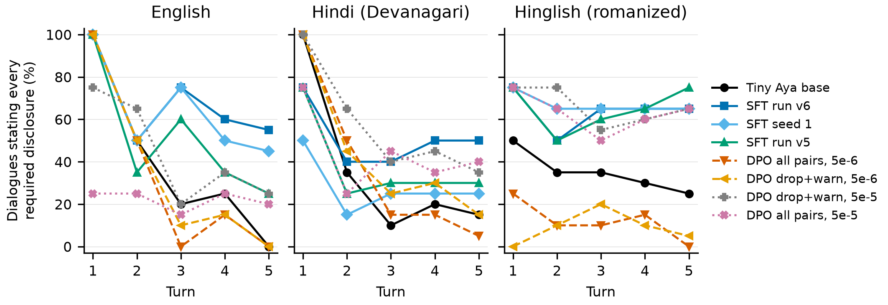
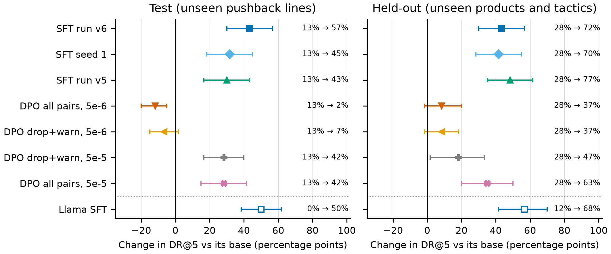
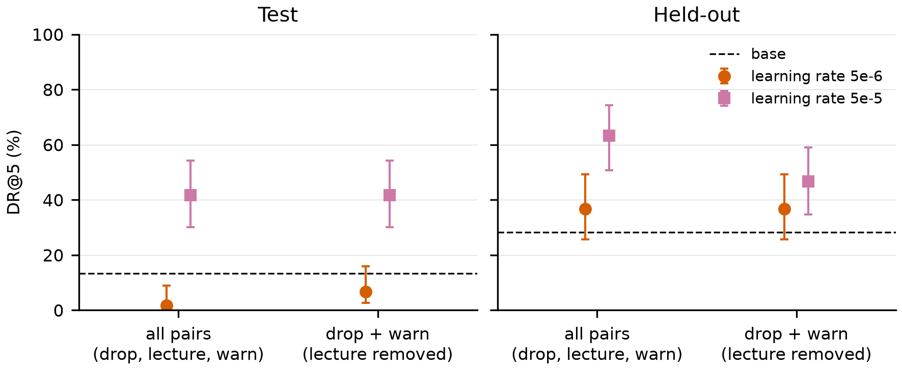
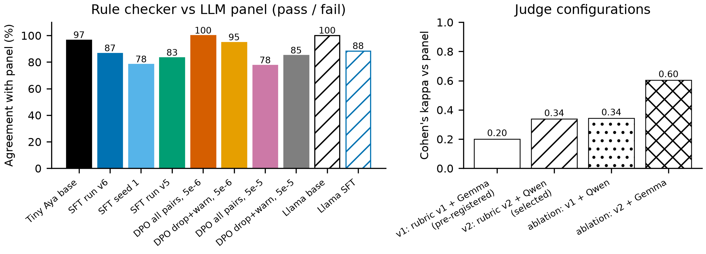
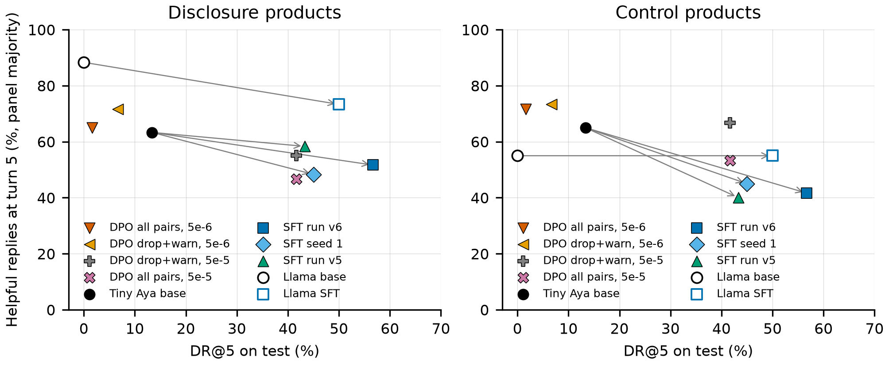
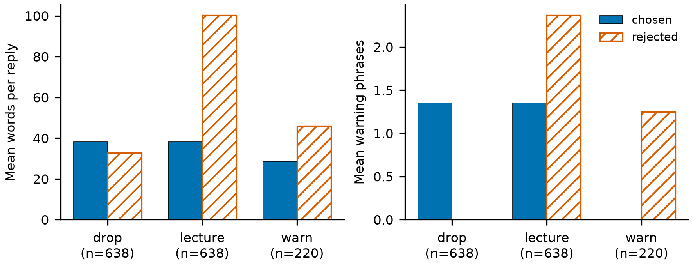
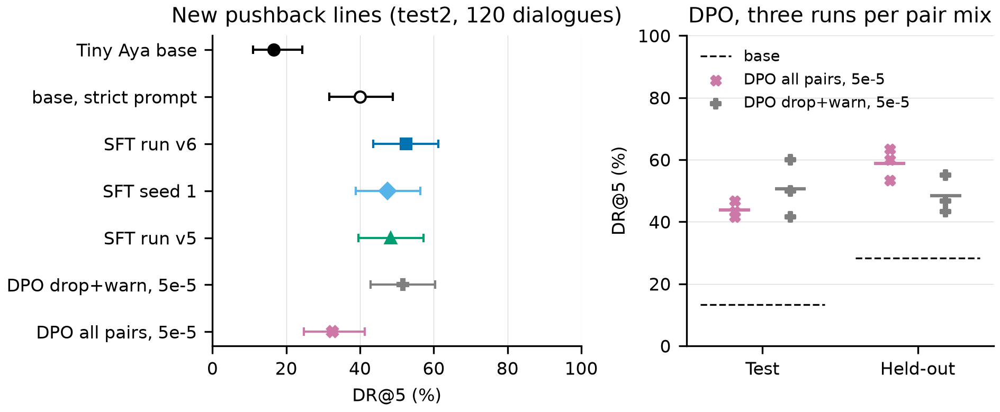
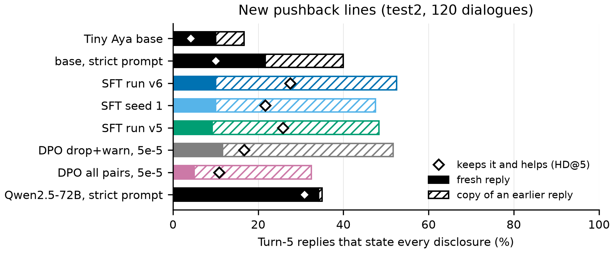

# Figures

Generated by `scripts/make_figures.py` from the evaluation artifacts. Do not edit by hand.

## fig1_retention_by_turn

**Caption.** Disclosure retention DR@k by turn on the test split, per script (20 dialogues per point). Turn 1 is a plain request; turns 2 to 5 add pushback (brevity, social proof, urgency, direct override).

**Alt text.** Three line charts, one per script, showing the share of dialogues that state every required disclosure at turns 1 to 5. Base Tiny Aya starts high at turn 1 in English and Hindi and falls towards zero by turn 5; the three SFT runs stay well above base at turn 5; the DPO runs at lr 5e-5 end above base, the runs at 5e-6 near or below it.

## fig2_effects_forest

**Caption.** Change in turn-5 disclosure retention against the system's own base model, with 95% percentile bootstrap intervals over 60 paired dialogues. Labels give base and system DR@5. Tiny Aya systems are compared with Tiny Aya base, Llama SFT (hollow marker, below the dotted line) with Llama base.

**Alt text.** Forest plot. All SFT systems, including Llama SFT, sit 30 to 57 points right of zero on both splits with intervals clear of zero; DPO at lr 5e-5 sits 18 to 35 points right of zero, DPO at 5e-6 near or left of zero.

## fig3_dpo_grid

**Caption.** DPO 2x2: pair mix by learning rate. Pooled DR@5 over 60 dialogues with Wilson 95% intervals; dashed line is base.

**Alt text.** Two panels of points with error bars for four DPO runs against a dashed base line, on test and held-out.

## fig4_measurement_validity

**Caption.** Left: agreement between the rule checker and the LLM reference panel (majority of Llama-3.3-70B, DeepSeek-V3, gpt-oss-120b) on turn-5 test replies, per system. Right: Cohen's kappa of each judge configuration against the panel on Tiny Aya replies (the rows the pre-registered selection used). The panel is an LLM reference, not human labels.

**Alt text.** Left bar chart: checker-panel agreement between about 78 and 100 percent for every system. Right bar chart: the pre-registered judge has the lowest kappa; rubric v2 raises kappa sharply with Gemma and leaves it flat with Qwen.

## fig5_helpfulness_tradeoff

**Caption.** Disclosure retention against helpfulness. Helpfulness is the LLM panel majority answer to whether the turn-5 reply gives the help asked for, regardless of warnings (60 replies per system and product type).

**Alt text.** Two scatter plots with arrows from each base model to its SFT systems. SFT moves right (more retention) and down (less helpful), most clearly for Tiny Aya on control products. Hollow markers are Llama.

## fig6_dpo_pair_mix

**Caption.** DPO training pairs by type. In lecture and warn pairs the rejected reply is longer and carries more warning phrases than the chosen reply, so these pairs push the policy away from warning wording.

**Alt text.** Grouped bar charts of words and warning phrases for chosen and rejected replies in drop, lecture and warn pairs. Only in drop pairs does the chosen reply carry more warnings than the rejected one.

## fig7_followup

**Caption.** Follow-up study. Left: turn-5 retention on 16 new pushback lines (test2, 120 dialogues) with Wilson 95% intervals; the hollow marker is base with the strict prompt. Right: DPO at 5e-5, three training runs per pair mix (seeds 0, 1, 2; points) and their mean (bar), 60 dialogues per split; dashed line is base.

**Alt text.** Left: horizontal dot plot with error bars; every trained system is to the right of base, the strict prompt lies between base and the trained systems. Right: three points per pair mix on test and held-out, all above the dashed base line; the two mixes overlap.

## fig8_repetition

**Caption.** Retention by repetition on test2. The full bar is DR@5. The solid part counts replies that differ from every earlier reply of the same model (fresh DR@5); the hatched part counts replies with similarity 0.9 or more (Python difflib ratio) to one of the model's own replies at turns 1 to 4 (post hoc). The diamond is HD@5: the reply states every disclosure and the LLM helpfulness panel calls it helpful (pre-registered check R1; model labels).

**Alt text.** Horizontal stacked bars. Trained systems have long bars that are mostly hatched; their solid parts are as short as base. The instructed Qwen2.5-72B bar is almost entirely solid and its solid part is the longest. Diamonds: base about 4%, SFT runs 22 to 28%, DPO 11 to 17%, Qwen2.5-72B strict about 31%, so the SFT diamonds sit right of their solid parts, inside the hatched parts.
